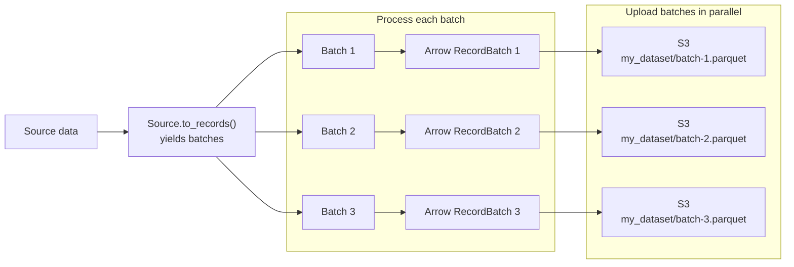

# Advanced connector authoring

This guide shows how to write `viadot` source connectors that scale to large datasets without blowing up memory usage or wasting time on avoidable I/O latency. Whenever possible, a connector should:

- fetch and process data lazily, using iterators/generators instead of loading everything into memory up front
- return data in batches, so the size of a single batch (not the size of the whole source) determines memory use
- let the user configure the batch size via a `batch_size` parameter on `to_df()`/`to_arrow()`, and the corresponding Prefect task and flow
- fetch independent pages/requests concurrently instead of sequentially, where the source allows it
- prefer `pyarrow.Table` over `pandas.DataFrame` for I/O and interchange, and [polars](https://pola.rs/) over pandas for any in-memory data processing.

## Visualization



## Why this matters

A connector that reads an entire source into a single `list`/`DataFrame` before returning it will use memory proportional to the _whole_ source. For a small REST API that's fine, but for a database table with hundreds of millions of rows, it can crash the process (or the Prefect worker running it). Even a much smaller dataset can cause issues if it becomes a [noisy neighbor](https://docs.aws.amazon.com/wellarchitected/latest/saas-lens/noisy-neighbor.html), as the orchestrator is usually running multiple ingestion jobs in parallel. Using pre-defined batch sizes not only prevents that, but allows for highly deterministic memory usage patterns in ingestion workloads, making orchestration easier to manage and optimize.

Generators let us fetch and yield data as it becomes available, so we never hold more than one page/batch in memory at a time. Combining this with a `batch_size` parameter lets the _user_ of the connector - not the connector author - decide the memory/throughput trade-off for their environment.

## Viadot's in-memory format

While currently `viadot` does not have a standard in-memory format, `pyarrow.Table`/`pyarrow.RecordBatch` is preferred over `pandas.DataFrame` because it:

- has a much smaller memory footprint
- supports zero-copy interop with tools like polars and DuckDB
- maps directly to columnar file formats (Parquet) used by most `viadot` destinations.

Pandas is still supported for backwards compatibility (via `to_df()`), but new code should treat `to_arrow()` as the primary method, and only use `to_df()` (inherited from the parent `Source` class) if required.

## Walkthrough

We'll build a small connector for [JSONPlaceholder](https://jsonplaceholder.typicode.com/), a free fake REST API commonly used for testing and prototyping. It requires no credentials, so every snippet below can be copy-pasted and executed as-is. JSONPlaceholder supports paging through `/posts?_page=1` (optionally with `_limit`), which is a typical pattern for REST APIs.

## 1. Process data in batches

### Fetch data lazily with a generator

Instead of requesting every post at once and collecting the response into one big list, we implement `_to_records()` as a generator: it fetches and yields one batch at a time, so at most one page is ever held in memory. Note that other connectors can use a database cursor, a file reader, or any other record filtering method instead of pagination.

The basic idea is very simple - see below pseudocode:

```python
def get_data_in_batches():
    # Assume get_results() fetches results one page at a time.
    for page in range(5):
        # Generate a batch.
        yield get_results(page=page)
```

Example:

```python
# sources/jsonplaceholder.py

"""JSONPlaceholder connector (a free fake REST API, useful for prototyping)."""

from collections.abc import Iterator

import requests

from viadot.sources.base import Source


class JSONPlaceholder(Source):
    """Connector for https://jsonplaceholder.typicode.com."""

    BASE_URL = "https://jsonplaceholder.typicode.com"
    # Most APIs contain either a link to the next page, or the total number of pages
    # in the result. However, this example API does not have these, so we must
    # hardcode the number of pages here.
    N_PAGES = 10
    # This connector natively supports precise batching - see the note below this code
    # snippet.
    supports_batch_size = True

    def _to_records(self, batch_size: int | None = 10) -> Iterator[list[dict]]:
        """Lazily fetch posts, yielding one page at a time as a batch.

        Fetching one page of specified size at a time (instead of requesting all posts
        at once) means memory use never grows with the total size of the source.
        """

        # Paging is used by most modern REST APIs to limit response size.
        # For other APIs and data sources such as databases, you will typically
        # need to use some form of filtering to achieve the same goal.
        for page_number in range(1, self.N_PAGES + 1):
            response = requests.get(
                f"{self.BASE_URL}/posts",
                params={"_page": page_number, "_limit": batch_size},
                timeout=5,
            )
            response.raise_for_status()
            records = response.json()
            if not records:
                break
            yield records
```

### Batch records into user-configurable batches

The base `Source` class implements a `to_records()` method, which is the generic batching layer: it delegates source-specific fetching to `_to_records()`, then exposes every connector as a lazy stream of batches of requested `batch_size`:

```python
# sources/jsonplaceholder.py

class JSONPlaceholder(Source):
    ...

source = MyConnector()
for batch_items in source.to_records(batch_size=25):
    ...  # Regardless of how much data each batch returned by `_to_records()` contains,
         # `batch_items` always contains at most 25 records.
```

In simple terms, this method ensures that each `viadot` connector supports the `batch_size` parameter -- regardless of whether the connector actually supports such feature natively.

Omitting `batch_size` uses the connector's default, capped by the configured
library-wide maximum (20,000 by default). The cap applies to both native and
generic batching. Passing `batch_size=None` explicitly disables batching and
requests one materialized result. An explicitly requested integer is also
capped by the library-wide maximum.

!!! note "More on `to_records()`"

    While some sources, such as the example above, allow us to implement precise batching (thanks to, in this case, the `_limit` parameter), it's not always the case -- for example, some sources might return pages of variable, server-side-controlled size. Despite that, by re-batching the data internally within `Source.to_records()`, we're able to **guarantee** that each connector supports the `batch_size` parameter.

    However, as re-batching requires additional processing and memory use, whenever possible, make sure to utilize the `batch_size` parameter in `_to_records()` to return batches of the specified size, so that `viadot` can skip this additional processing.

    Whether the connector supports `batch_size` natively or the feature is provided by the `viadot` library, being able to precisely control the size of connector's output is still very valuable for improved control over downstream processing (eg. parallel processing, muti-part uploads, etc.).

### Return batches as Arrow tables

`Source.to_arrow()` consumes the public `to_records()` interface. When
`batch_size` is `None`, it materializes all records into one `pa.Table`. When
`batch_size` is set, it lazily converts each record batch into a
`pa.RecordBatch`; nothing is fetched until the caller starts iterating.

Most connectors only need to implement `_to_records()` and inherit
`Source.to_arrow()` unchanged:

```python
from viadot.sources import JSONPlaceholder

source = JSONPlaceholder()

# One materialized table.
table = source.to_arrow()

# A lazy iterator of RecordBatch objects.
for record_batch in source.to_arrow(batch_size=25):
    ...  # process one batch at a time
```

### Optionally return pandas DataFrames

`Source.to_df()` is available as a convenience when pandas output is needed;
otherwise, prefer the Arrow-based `to_arrow()` API described above.

```python
from viadot.sources import JSONPlaceholder

df = JSONPlaceholder().to_df()
```

### Expose the batch size on the Prefect task and flow

To let this scale end-to-end, thread `batch_size` through the task...

```python
# orchestration/prefect/tasks/jsonplaceholder.py

"""Tasks for interacting with JSONPlaceholder."""

from collections.abc import Iterator

import pandas as pd
from prefect import task

from viadot.sources import JSONPlaceholder


@task(retries=3, retry_delay_seconds=10)
def jsonplaceholder_to_df(
    batch_size: int | None = None,
) -> pd.DataFrame | Iterator[pd.DataFrame]:
    """Download data from JSONPlaceholder into (an iterator of) DataFrame(s).

    Args:
            batch_size (int, optional): Maximum number of rows per batch. If set,
            returns a generator of DataFrames instead of a single one. Use
            this to bound the task's memory use for large sources. Defaults
            to None.
    """
    return JSONPlaceholder().to_df(batch_size=batch_size)
```

...and the flow, writing each batch to the destination as soon as it's ready
instead of waiting for the entire dataset:

```python
# orchestration/prefect/flows/jsonplaceholder_to_adls.py

"""Flow for pulling data from JSONPlaceholder into Azure Data Lake."""

from prefect import flow

from viadot.orchestration.prefect.tasks import df_to_adls, jsonplaceholder_to_df


@flow(
    name="extract--jsonplaceholder--adls",
    description="Extract data from JSONPlaceholder and load it into Azure Data Lake.",
)
def jsonplaceholder_to_adls(
    adls_dir: str,
    batch_size: int | None = None,
    overwrite: bool = False,
) -> None:
    """Download data from JSONPlaceholder and upload it to Azure Data Lake.

    Args:
        adls_dir (str): The destination directory. Each batch is written as a
            separate file, so results in a single-DataFrame ("no batching")
            run are also written as `part_0.parquet`.
        batch_size (int, optional): See `jsonplaceholder_to_df()`. Defaults to
            None.
        overwrite (bool, optional): Whether to overwrite files in the lake.
            Defaults to False.
    """
    dfs = jsonplaceholder_to_df(batch_size=batch_size)
    if batch_size is None:
        dfs = [dfs]

    for i, df in enumerate(dfs):
        df_to_adls(
            df=df,
            path=f"{adls_dir}/part_{i}.parquet",
            overwrite=overwrite,
        )
```

!!! note "Batched results and Prefect task caching/retries"

    Consuming a generator returned by a task works fine within a single flow run, since the flow consumes it immediately. However, if you enable Prefect result persistence or caching for the task, avoid returning a generator - it can only be iterated once, so a cached/replayed result would be empty on the second read. In that case, either disable caching for the task, or have the task write batches to the destination itself (or to intermediate files) and return only a summary (e.g. row count).

## 2. Process data asynchronously

Batches bound memory use, but batching doesn't help when a connector is _latency_-bound rather than memory-bound - for example, our `JSONPlaceholder` connector makes independent page requests one after another. Since these requests don't depend on each other, we can fetch them concurrently with [`httpx`](https://www.python-httpx.org/)'s async client instead, cutting wall-clock time roughly by a factor of the concurrency level.

!!! note "requests vs. httpx"

    `viadot` connectors currently use `requests` for HTTP calls, and that's fine for simple, sequential fetches. `httpx` is a drop-in-compatible replacement that additionally supports async/await, so it's the natural choice specifically when you need concurrency. There's no need to migrate existing synchronous code to `httpx` just for its own sake.

### Fetch data concurrently with `httpx.AsyncClient`

`_get_records_async()` mirrors `_get_records()`, but issues the page requests concurrently, bounded by a semaphore so we don't overwhelm the API (or hit its rate limits):

```python
# sources/jsonplaceholder.py

import asyncio
from collections.abc import AsyncIterator

import httpx


class JSONPlaceholder(Source):
    ...

    MAX_CONCURRENT_REQUESTS = 5

    async def _get_records_async(
        self, batch_size: int = 10
    ) -> AsyncIterator[list[dict]]:
        """Concurrently fetch posts, yielding batches as requests complete.

        A semaphore caps the number of in-flight requests, so we get the
        speedup of concurrency without risking overwhelming the API or
        spiking memory with too many simultaneous responses.
        """
        semaphore = asyncio.Semaphore(self.MAX_CONCURRENT_REQUESTS)

        async def fetch(
            client: httpx.AsyncClient, page_number: int
        ) -> tuple[int, list[dict]]:
            async with semaphore:
                response = await client.get(
                    f"{self.BASE_URL}/posts",
                    params={"_page": page_number, "_limit": batch_size},
                    timeout=10,
                )
                response.raise_for_status()
                return page_number, response.json()

        async with httpx.AsyncClient() as client:
            tasks = [
                fetch(client, page_number)
                for page_number in range(1, self.N_PAGES + 1)
            ]
            for task in asyncio.as_completed(tasks):
                _, records = await task
                yield records
```

### Convert asynchronous batches to Arrow

The asynchronous fetcher already yields page-sized batches, so no additional
async re-batching helper is needed. A specialized async conversion can create
one `RecordBatch` per fetched page:

```python
# sources/jsonplaceholder.py

import pyarrow as pa


class JSONPlaceholder(Source):
    ...

    async def to_arrow_async(
        self, batch_size: int | None = None
    ) -> pa.Table | AsyncIterator[pa.RecordBatch]:
        """Fetch pages concurrently and return Arrow data."""
        if batch_size is None:
            batches = [batch async for batch in self._get_records_async(batch_size)]
            records = [record for batch in batches for record in batch]
            return pa.Table.from_pylist(records)

        return (
            pa.RecordBatch.from_pylist(batch_items)
            async for batch_items in self._get_records_async(batch_size)
        )
```

### Async Prefect tasks and flows

Prefect tasks and flows can be defined with `async def` directly - there's no need to bridge back to sync code with `asyncio.run()` as long as the whole call chain (task and flow) is async:

```python
# orchestration/prefect/tasks/jsonplaceholder.py

from collections.abc import AsyncIterator

import pyarrow as pa
from prefect import task

from viadot.sources import JSONPlaceholder


@task(retries=3, retry_delay_seconds=10)
async def jsonplaceholder_to_arrow_async(
    batch_size: int | None = None,
) -> pa.Table | AsyncIterator[pa.RecordBatch]:
    """Async equivalent of `jsonplaceholder_to_df()`."""
    return await JSONPlaceholder().to_arrow_async(batch_size=batch_size)
```

```python
# orchestration/prefect/flows/jsonplaceholder_to_adls.py

from prefect import flow

from viadot.orchestration.prefect.tasks import (
    df_to_adls,
    jsonplaceholder_to_arrow_async,
)


@flow(
    name="extract--jsonplaceholder--adls-async",
    description="Extract data from JSONPlaceholder concurrently and load it into Azure Data Lake.",
)
async def jsonplaceholder_to_adls_async(
    adls_dir: str,
    batch_size: int | None = None,
    overwrite: bool = False,
) -> None:
    """Async equivalent of `jsonplaceholder_to_adls()`."""
    result = await jsonplaceholder_to_arrow_async(batch_size=batch_size)

    if isinstance(result, pa.Table):
        df_to_adls(
            df=result.to_pandas(),
            path=f"{adls_dir}/part_0.parquet",
            overwrite=overwrite,
        )
        return

    i = 0
    async for record_batch in result:
        df_to_adls(
            df=pa.Table.from_batches([record_batch]).to_pandas(),
            path=f"{adls_dir}/part_{i}.parquet",
            overwrite=overwrite,
        )
        i += 1
```

Note that `df_to_adls` itself stays a regular (sync) task - Prefect allows mixing sync and async tasks freely within an async flow.

## 3. Prefer Arrow tables (and polars) over pandas DataFrames

As shown in section 1, `to_arrow()` (not `to_df()`) should be the primary method - `to_df()` is a thin wrapper around it kept for backwards compatibility. The same applies to any in-memory transformation you need to do on a batch before returning it: reach for [polars](https://pola.rs/) rather than pandas. Polars operates natively on Arrow's columnar memory layout, so converting a batch `Table` to a `polars.DataFrame`, transforming it, and converting it back is close to zero-copy, whereas going through pandas requires additional data copies and type conversions.

```python
import polars as pl


def _transform(table: pa.Table) -> pa.Table:
    df = pl.from_arrow(table)
    df = df.with_columns(pl.col("title").str.to_uppercase())
    return df.to_arrow()
```

## Testing batched connectors

Test both the default (single-object) path and the batched path, and confirm that batching doesn't change the data - only how it's grouped:

```python
# tests/unit/test_jsonplaceholder.py

import pandas as pd

from viadot.sources import JSONPlaceholder


def test_to_df_no_batching(mock_jsonplaceholder_api):
    df = JSONPlaceholder().to_df()

    assert isinstance(df, pd.DataFrame)
    assert not df.empty


def test_to_df_batching(mock_jsonplaceholder_api):
    dfs = list(JSONPlaceholder().to_df(batch_size=5))

    assert all(len(batch) <= 5 for batch in dfs)
    assert sum(len(batch) for batch in dfs) == len(JSONPlaceholder().to_df())
```

See [Creating a source](creating_a_source.md#adding-tests) for how to mock the API so these tests don't require network access. For the async variants, use [`pytest-asyncio`](https://pytest-asyncio.readthedocs.io/) and mock `httpx.AsyncClient` the same way.

## Summary

| Concern              | Guidance                                                                                                                        |
| -------------------- | ------------------------------------------------------------------------------------------------------------------------------- |
| Fetching data        | Use generators (`yield`) instead of building full lists/DataFrames.                                                             |
| Returning data       | Add `batch_size` to `to_df()`/`to_arrow()`; when set, return a generator of batches.                                            |
| Independent requests | Fetch concurrently with `httpx.AsyncClient`, bounded by a semaphore.                                                            |
| Prefect tasks/flows  | Expose the same `batch_size` parameter and write each batch as it arrives; use `async def` throughout if fetching concurrently. |
| Data format          | Implement `to_arrow()` as the primary method; derive `to_df()` from it. Use polars, not pandas, for any transforms.             |

For everything else involved in building a connector (credentials, config, optional dependencies, docs), see [Creating a source](creating_a_source.md).
